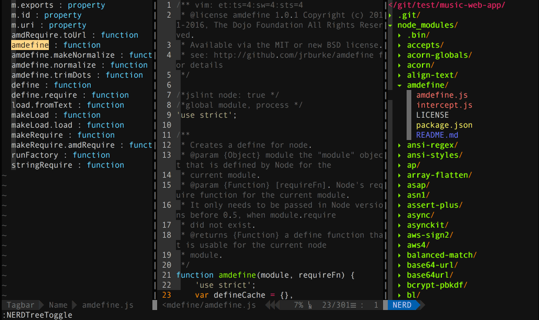

<div markdown="1">
  <sup>使用 <a href="https://wangchujiang.com/#/app" target="_blank">我的应用</a> 也是一种 <a href="https://wangchujiang.com/#/sponsor" target="_blank">支持</a> 我的方式：</sup>
  <br>
  <a target="_blank" href="https://apps.apple.com/app/6758053530" title="Scap: Screenshot & Markup Edit for macOS"></a>
  <a target="_blank" href="https://apps.apple.com/app/6757317079" title="Screen Test for macOS"></a>
  <a target="_blank" href="https://apps.apple.com/app/Deskmark/6755948110" title="Deskmark for macOS"></a>
  <a target="_blank" href="https://apps.apple.com/app/Keyzer/6500434773" title="Keyzer for macOS"></a>
  <a target="_blank" href="https://github.com/jaywcjlove/vidwall-hub" title="Vidwall Hub for macOS"></a>
  <a target="_blank" href="https://apps.apple.com/app/VidCrop/6752624705" title="VidCrop for macOS"></a>
  <a target="_blank" href="https://apps.apple.com/app/Vidwall/6747587746" title="Vidwall for macOS"></a>
  <a target="_blank" href="https://wangchujiang.com/mousio-hint/" title="Mousio Hint for macOS"></a>
  <a target="_blank" href="https://apps.apple.com/app/6746747327" title="Mousio for macOS"></a>
  <a target="_blank" href="https://apps.apple.com/app/6745227444" title="Musicer for macOS"></a>
  <a target="_blank" href="https://apps.apple.com/app/6743841447" title="Audioer for macOS"></a>
  <a target="_blank" href="https://apps.apple.com/app/6744690194" title="FileSentinel for macOS"></a>
  <a target="_blank" href="https://apps.apple.com/app/6743495172" title="FocusCursor for macOS"></a>
  <a target="_blank" href="https://apps.apple.com/app/6742680573" title="Videoer for macOS"></a>
  <a target="_blank" href="https://apps.apple.com/app/6740425504" title="KeyClicker for macOS"></a>
  <a target="_blank" href="https://apps.apple.com/app/6739052447" title="DayBar for macOS"></a>
  <a target="_blank" href="https://apps.apple.com/app/6739444407" title="Iconed for macOS"></a>
  <a target="_blank" href="https://apps.apple.com/app/6737160756" title="Menuist for macOS"></a>
  <a target="_blank" href="https://apps.apple.com/app/6723903021" title="Paste Quick for macOS"></a>
  <a target="_blank" href="https://apps.apple.com/app/6670696072?platform=mac" title="Quick RSS for macOS/iOS"></a>
  <a target="_blank" href="https://apps.apple.com/app/6670167443" title="Web Serve for macOS"></a>
  <a target="_blank" href="https://apps.apple.com/app/6503953628?platform=mac" title="Copybook Generator for macOS/iOS"></a>
  <a target="_blank" href="https://apps.apple.com/app/6471227008?platform=mac" title="DevTutor for macOS/iOS"></a>
  <a target="_blank" href="https://apps.apple.com/app/6479819388?platform=mac" title="RegexMate for macOS/iOS"></a>
  <a target="_blank" href="https://apps.apple.com/app/6479194014?platform=mac" title="Time Passage for macOS/iOS"></a>
  <a target="_blank" href="https://apps.apple.com/app/6478772538" title="IconizeFolder for macOS"></a>
  <a target="_blank" href="https://apps.apple.com/app/6478511402?platform=mac" title="Textsound Saver for macOS/iOS"></a>
  <a target="_blank" href="https://apps.apple.com/app/6476924627" title="Create Custom Symbols for macOS"></a>
  <a target="_blank" href="https://apps.apple.com/app/6476452351" title="DevHub for macOS"></a>
  <a target="_blank" href="https://apps.apple.com/app/6476400184" title="Resume Revise for macOS"></a>
  <a target="_blank" href="https://apps.apple.com/app/6472593276" title="Palette Genius for macOS"></a>
  <a target="_blank" href="https://apps.apple.com/app/6470879005" title="Symbol Scribe for macOS"></a>
</div>
<hr>

<p align="center"></p>

<p align="center">Only tested on Mac OSx</p>

<p align="center">
  <a href="https://jaywcjlove.github.io/#/sponsor" target="_blank" title="Buy me a coffee">
    
  </a>
  <a href="https://x.com/jaywcjlove" title="Follow On X" target="_blank">
    
  </a>
</p>

<p align="center">在 <a href="https://github.com/jaywcjlove/vim-web/tree/vim-web">vim-web v2</a> 版本插件配置太多，新版本 v3 只配置少量的插件，是一个简单的版本。</p>


<!--idoc:ignore:start-->

目录
===

- [安装](#安装)
- [快捷键](#快捷键)
- [插件管理器](#插件管理器)
- [理解Vim](#理解vim)
- [菜单目录](#菜单目录)
- [HTML操作](#html操作)
- [代码导航](#代码导航)
- [文本内容搜索](#文本内容搜索)
- [插件列表](#插件列表)
- [参考资料](#参考资料)
- [其它人的vimrc配置](#其它人的vimrc配置)

<!--idoc:ignore:end-->

## 安装

最新版本的Vim 8.1+  使用下面命令安装 vim 版本并更新：

```bash
brew install macvim # 安装 macvim
brew install macvim --override-system-vim
```

将插件以及配置下载到 `~/.vim/` 目录中，这个目录是存放所有插件和配置的地方。vimscript是vim自己的一套脚本语言，通过这种脚本语言可以实现与 vim 交互，达到功能扩展的目的。一组 vimscript 就是一个 vim 插件，vim 的很多功能都由各式插件实现。

```shell
$ git clone https://github.com/jaywcjlove/vim-web.git ~/.vim
$ ln -s ~/.vim/.vimrc ~/.vimrc
# 插件管理器
curl -LSso ~/.vim/autoload/pathogen.vim https://tpo.pe/pathogen.vim
# 安装主题
curl -LSso ~/.vim/colors/molokai.vim https://raw.githubusercontent.com/fatih/molokai/master/colors/molokai.vim
```

或者**脚本下载安装**

```bash
# 安装 vim-web
curl -sLf https://raw.githubusercontent.com/jaywcjlove/vim-web/master/install | bash -s -- install
# 卸载 vim-web
curl -sLf https://raw.githubusercontent.com/jaywcjlove/vim-web/master/install | bash -s -- uninstall
```

## 快捷键

```bash
U # 选中 - 变大写 
u # 选中 - 变小写
~ # 选中 - 变大写变小写，小写变大写
##########
<ctrl+p> # 启动搜索文件
;tt      # 开启/关闭代码导航
;fl      # 开启/关闭目录菜单
:!which ls  # 找命令不推出vim运行命令
```

**整页翻页**

```bash
ctrl-f # 下一页 f 就是`forword` 
ctrl-d # 下半页 d 
ctrl-b # 上一页 b 就是`backward`  
ctrl-u # 上半页 u  
```

**保存退出**

```bash
:w new_filename     # → 保存为指定文件  
:w   # → 保存修改  
:wq  # → 保存修改并推出  
ZZ   # → 快捷键，保存修改并推出  
:q!  # → 不保存修改推出  
:wq! # → 保存修改并推出（文件所有者，root权限的用户）  
```

**文本编辑搜索等操作**

```bash
xp  # 左右交换光标处两字符的位置
:200,320 join # 合并第200~320行
J  # 选中多行合并

:r ~/git/R.js # 将文件内容导入到该文件中
:r !date    # 将当前编辑时间导入当前文本光标所在行
:!date      # 查看编辑时间

;sp # 选中搜索 - 文本中选中关键字
    # normal模式下 选中搜索 - 文本中选中关键字
;sl # 选中搜索 - 结果列表

;y  # 复制到剪切板
y   # 复制
yy  # 复制当前行
nyy # n表示大于1的数字，复制n行
yw  # 从光标处复制至一个单子/单词的末尾，包括空格
ye  # 从光标处复制至一个单子/单词的末尾，不包括空格
y$  # 从当前光标复制到行末
y0  # 从当前光标位置（不包括光标位置）复制之行首
y3l # 从光标位置（包括光标位置）向右复制3个字符
y5G # 将当前行（包括当前行）至第5行（不包括它）复制
y3B # 从当前光标位置（不包括光标位置）反向复制3个单词
.   # 粘贴
p   # 粘贴

# 多光标编辑
Shift+n # 选中下一个相同字符
Shift+k # 跳过当前选中的字符

:1,24s/header/www/g  # 第1到24行将header替换成www
```

**刷新重载打开的文件**

```bash
:e  # 刷新当前文件
:e! # 强制刷新当前文件
```

**简单排版**

```vimscript
:ce(nter)  # 居中显示光标所在行
:ri(ght)   # 靠右显示光标所在行
:le(ft)    # 靠左显示光标所在行
J          # 将光标所在下一行合并到光标所在行

>>         # 光标所在行增加缩进(一个tab)
<<         # 光标所在行减少缩进(一个tab)

n>>        # 光标所在行开始的n行增加缩进
n<<        # 光标所在行开始的n行减少缩进
```

## 插件管理器

插件管理器换成了 [Pathogen](https://github.com/tpope/vim-pathogen) 看上去比其它插件管理器更简单的样子，安装插件只需将插件放入 `bundle` 目录，在 `~/.vimrc` 配置即可。

## 理解Vim

这部分来源 [一起来说 Vim 语](http://www.jianshu.com/p/a361ce8c97bc)，理解此部分是需要你已经了解了 Vim 的几种常用的工作模式（正常模式、插入模式、命令模式等）

<details>
<summary>动词理解</summary>

动词代表了我们打算对文本进行什么样的操作。例如：

```bash
d # 表示删除delete
r # 表示替换replace
c # 表示修改change
y # 表示复制yank
v # 表示选取visual select
```

</details>

<details>
<summary>名词理解</summary>

名词代表了我们即将处理的文本。Vim 中有一个专门的术语叫做 [文本对象] text object，下面是一些文本对象的示例：

```bash
w # 表示一个单词word
s # 表示一个句子sentence
p # 表示一个段落paragraph
t # 表示一个 HTML 标签tag
引号或者各种括号所包含的文本称作一个文本块。
```

</details>

<details>
<summary>介词理解</summary>

介词界定了待编辑文本的范围或者位置。

```bash
i # 表示在...之内 inside
a # 表示环绕... around
t # 表示到...位置前 to
f # 表示到...位置上 forward
```

</details>

<details>
<summary>数词理解</summary>

数词指定了待编辑文本对象的数量，从这个角度而言，数词也可以看作是一种介词。引入数词之后，文本编辑命令的语法就升级成了下面这样：

```
动词 介词/数词 名词
```

下面是几个例子：

```bash
c3w  # 修改三个单词：change three words
d2w  # 删除两个单词：delete two words
```

另外，数词也可以修饰动词，表示将操作执行 n 次。于是，我们又有了下面的语法：

```
数词 动词 名词
```

请看示例：

```bash
2dw # 两次删除单词（等价于删除两个单词）: twice delete word
3x  # 三次删除字符（等价于删除三个字符）：three times delete character
```

</details>

<details>
<summary>组词为句理解</summary>

有了这些基本的语言元素，我们就可以着手构造一些简单的命令了。文本编辑命令的基本语法如下：

```
动词 介词 名词
```

下面是一些例子（如果熟悉了上面的概念，你将会看到这些例子非常容易理解），请亲自在 Vim 中试验一番。

```bash
dip # 删除一个段落: delete inside paragraph
vis # 选取一个句子: visual select inside sentence
ciw # 修改一个单词: change inside word
caw # 修改一个单词: change around word
dtx # 删除文本直到字符“x”（不包括字符“x”）: delete to x
dfx # 删除文本直到字符“x”（包括字符“x”）: delete forward x
```

</details>


## 菜单目录

工程文件菜单插件 [scrooloose/nerdtree](https://github.com/scrooloose/nerdtree) 

```bash
ctrl + i # 菜单显示隐藏文件
;fl      # 显示文件菜单 file list
# 可以直接在Tab之间切换。
gt # 后一个Tab标签
gT # 前一个Tab标签
```

```bash
ma # 新建文件，新建目录，文件目录 'folder/' 记住后面的斜杠
```

```bash
shift+i      # 显示/隐藏隐藏文件 
t       # 在新 Tab 中打开选中文件/书签，并跳到新 Tab
T       # 在新 Tab 中打开选中文件/书签，但不跳到新 Tab
i       # split 一个新窗口打开选中文件，并跳到该窗口
gi      # split 一个新窗口打开选中文件，但不跳到该窗口
s       # vsplit 一个新窗口打开选中文件，并跳到该窗口
gs      # vsplit 一个新 窗口打开选中文件，但不跳到该窗口

ctrl + w + h    # 光标 focus 左侧树形目录
ctrl + w + l    # 光标 focus 右侧文件显示窗口
ctrl + w + w    # 光标自动在左右侧窗口切换
ctrl + w + r    # 移动当前窗口的布局位置
o       # 在已有窗口中打开文件、目录或书签，并跳到该窗口
go      # 在已有窗口 中打开文件、目录或书签，但不跳到该窗口

!       # 执行当前文件
O       # 递归打开选中 结点下的所有目录
x       # 合拢选中结点的父目录
X       # 递归 合拢选中结点下的所有目录，收起当前目录树
e       # Edit the current dif

双击    相当于 NERDTree-o
中键    对文件相当于 NERDTree-i，对目录相当于 NERDTree-e

D       # 删除当前书签
#
P       # 跳到根结点
p       # 跳到父结点
K       # 跳到当前目录下同级的第一个结点
J       # 跳到当前目录下同级的最后一个结点
k       # 跳到当前目录下同级的前一个结点
j       # 跳到当前目录下同级的后一个结点

C       # 将选中目录或选中文件的父目录设为根结点
u       # 将当前根结点的父目录设为根目录，并变成合拢原根结点
U       # 将当前根结点的父目录设为根目录，但保持展开原根结点
r       # 递归刷新选中目录，刷新当前目录
R       # 递归刷新根结点，刷新根目录树
m       # 显示文件系统菜单
cd      # 将 CWD 设为选中目录

I       # 切换是否显示隐藏文件
f       # 切换是否使用文件过滤器
F       # 切换是否显示文件
B       # 切换是否显示书签
#
q       # 关闭 NerdTree 窗口
?       # 切换是否显示 Quick Help
```

## HTML操作

便捷操作得益于插件[Emmet.vim](https://github.com/mattn/emmet-vim)。键入 `div>p#foo$*3>a` 然后按快捷键 `<c-y>,` – 表示 `<Ctrl-y>` 后再按逗号【<kbd>Ctrl</kbd><kbd>y</kbd><kbd>,</kbd>】。

新建 `vim index.html` 文件，输入 `html:5_` 使用快捷键 <kbd>Ctrl</kbd><kbd>y</kbd><kbd>,</kbd>，即可初始化一个 HTML 文件。

按大写的 `V` 进入 Vim 可视模式，行选取上面三行内容，然后按键 <kbd>Ctrl</kbd>+<kbd>y</kbd>+<kbd>,</kbd>，这时 Vim 的命令行会提示 `Tags:`，键入 `ul>li*`，然后按 `Enter`。

```shell
<ctrl+y>d # 根据光标位置选中整个标签  
<ctrl+y>D # 根据光标位置选中整个标签内容  
<ctrl-y>n # 跳转到下一个编辑点  
<ctrl-y>N # 跳转到上一个编辑点  
<ctrl-y>i # 更新图片大小  
<ctrl-y>m # 合并成一行  
<ctrl-y>k # 移除标签对  
<ctrl-y>j # 分割/合并标签  
<ctrl-y>/ # 切换注释  
<ctrl-y>a # 从 URL 地址生成锚  
<ctrl-y>A # 从 URL 地址生成引用文本  
```

## 代码导航

通过 [majutsushi/tagbar](https://github.com/majutsushi/tagbar) 插件实现，Vim 的类代码地图查看器，通过 `:TagbarToggle` 来查看。

```bash
;tt # 开启/关闭导航
```

## 文本内容搜索

通过 [easymotion/vim-easymotion](https://github.com/easymotion/vim-easymotion) 插件可以丰富搜索

```bash
;f  # 启动搜索输入字母，出现位置选择
;e  # 下一页随机位置
;b  # 上一页随机位置
;n  # 下一页随机位置
```

基本搜索，这种搜索不需要依赖任何插件，输入 <kbd>/</kbd> 再输入需要搜索的内容，摁 <kbd>Enter</kbd> 键，将会高亮所有搜索的内容，在英文状态下摁 <kbd>n</kbd> 字母键向下查找，下次打开文件时，这些字符串仍然高亮显示，使用命令`:nohl`取消高亮显示。

`/pattern<Enter>`：向下查找pattern匹配字符串   
`?pattern<Enter>`：向上查找pattern匹配字符串，使用了查找命令之后，使用如下两个键快速查找：  
`n`：按照同一方向继续查找   
`N`：按照反方向查找   

```shell
/^abc<Enter>       # 查找以abc开始的行 
/test$<Enter>      # 查找以abc结束的行 
//^test<Enter>     # 查找^tabc字符串
:s/vivian/sky/     # 替换当前行第一个 vivian 为 sky
:s/vivian/sky/g    # 替换当前行所有 vivian 为 sky
:n,$s/vivian/sky/  # 替换第 n 行开始到最后一行中每一行的第一个 vivian 为 sky
:n,$s/vivian/sky/g # 替换第 n 行开始到最后一行中每一行所有 vivian 为 sky
                   #（n 为数字，若 n 为 .，表示从当前行开始到最后一行）
:%s/vivian/sky/  #（等同于 :g/vivian/s//sky/） 替换每一行的第一个 vivian 为 sky
:%s/vivian/sky/g #（等同于 :g/vivian/s//sky/g） 替换每一行中所有 vivian 为 sky

:s#vivian/#sky/#      # 替换当前行第一个 vivian/ 为 sky/
:%s+/oradata/apras/+/user01/apras1+ 
#（使用+ 来 替换 / ）： /oradata/apras/替换成/user01/apras1/

:s/str1/str2/          # 用字符串 str2 替换行中首次出现的字符串 str1
:s/str1/str2/g         # 用字符串 str2 替换行中所有出现的字符串 str1
:.,$ s/str1/str2/g     # 用字符串 str2 替换正文当前行到末尾所有出现的字符串 str1
:1,$ s/str1/str2/g     # 用字符串 str2 替换正文中所有出现的字符串 str1
:g/str1/s//str2/g      # 功能同上

//<abc  # 查找以test开始的字符串 
/abc/>  # 查找以test结束的字符串 

$       # 匹配一行的结束
^       # 匹配一行的开始
/<      # 匹配一个单词的开始，例如//<abc<Enter>:查找以abc开始的字符串
/>      # 匹配一个单词的结束，例如/abc/><Enter>:查找以abc结束的字符串 

*       # 匹配0或多次
/+      # 匹配1或多次
/=      # 匹配0或1次

.       # 匹配除换行符以外任意字符    
/a      # 匹配一个字符
/d      # 匹配任一数字      
/u      # 匹配任一大写字母

[]      # 匹配范围，如t[abcd]s 匹配tas tbs tcs tds
/{}     # 重复次数，如a/{3,5} 匹配3~5个a
/( /)   # 定义重复组，如a/(xy/)b 匹配ab axyb axyxyb axyxyxyb ...
/|      # 或，如：for/|bar 表示匹配for或者bar

/%20c   # 匹配第20列
/%20l   # 匹配第20行

# 切换 向上和向下搜索
# 输入 / 摁 Enter键，再摁 n 字母键向，下查找
# 输入 ? 摁 Enter键，再摁 n 字母键向，上查找
```

上面是全文搜索，下面是简单的单行搜索

```shell
fx  # 到第一个x
2fx # 到第二个x
Fx  # 往回查找
```

vim搜索时默认是大小写敏感的，要想实现大小写不敏感的搜索，如果仅仅是对当前打开的文件设置就用`:set ignorecase`，而永久性的设置可以到vimrc配置文件中添加一行

```vim
set ignorecase
```

## 文件搜索

搜索文件有多个插件 [junegunn/fzf.vim](https://github.com/junegunn/fzf.vim)、[Yggdroot/LeaderF](https://github.com/Yggdroot/LeaderF)、[wincent/command-t](https://github.com/wincent/command-t) 和 [kien/ctrlp.vim](https://github.com/kien/ctrlp.vim)，这里使用的 [Ctrlp](https://github.com/kien/ctrlp.vim) 使用 <kbd>Ctrl</kbd><kbd>p</kbd> 启动文件搜索。

```bash
<ctrl+p> # 启动搜索
```

## 插件列表

这里面所有的插件，并不是都放到了我的 [.vimrc](./.vimrc) 文件中 .vimrc 配置文件中，是我个人喜欢并且习惯的配置。

<details>
<summary>插件管理工具</summary>

- [junegunn/vim-plug](https://github.com/junegunn/vim-plug)
- [VundleVim/Vundle.vim](https://github.com/VundleVim/Vundle.vim)

</details>

<details>
<summary>主题风格</summary>

- [vim-colors-solarized](https://github.com/altercation/vim-colors-solarized) 主题风格素雅 solarized
- [molokai](https://github.com/tomasr/molokai) 主题风格多彩 molokai
- [phd](https://github.com/vim-scripts/phd) 主题风格复古 phd

</details>

<details>
<summary>使用界面</summary>

- [Mango](https://github.com/goatslacker/mango.vim) A nice color scheme
- [VimAirline](https://github.com/bling/vim-airline) 美化状态栏偏好设置
- [vim-powerline](https://github.com/Lokaltog/vim-powerline) 美化状态栏
- [vim-airline](https://github.com/vim-airline/vim-airline) 美化状态栏和配置
- [vim-airline-themes](https://github.com/vim-airline/vim-airline-themes) airline主题

</details>

<details>
<summary>管理项目</summary>

- [NERDTree](https://github.com/scrooloose/nerdtree) Manage your project files
- [VimFugitive](https://github.com/tpope/vim-fugitive) Git 集成
- [VimGitGutter](https://github.com/airblade/vim-gitgutter) Git 集成，强烈推荐！
- [EditorconfigVim](https://github.com/editorconfig/editorconfig-vim) Shared coding conventions
- [command-t](https://github.com/wincent/command-t) 文件搜索
- [vim-signature](https://github.com/kshenoy/vim-signature) 书签可视化的插件
- [BOOKMARKS--Mark-and-Highlight-Full-Lines](https://github.com/vim-scripts/BOOKMARKS--Mark-and-Highlight-Full-Lines) 它可以让书签行高亮
- [tagbar](https://github.com/majutsushi/tagbar) 方法地图导航
- [indexer.tar.gz](https://github.com/vim-scripts/indexer.tar.gz) 自动生成标签并引入
  - [DfrankUtil](https://github.com/vim-scripts/DfrankUtil) 上面插件，依赖这个插件
  - [vimprj](https://github.com/vim-scripts/vimprj) 上面插件，依赖这个插件
- [ctrlsf.vim](https://github.com/dyng/ctrlsf.vim) 上下文插件，例如搜素到关键字，中间缩略，展示一段上下文
- [vim-multiple-cursors](https://github.com/terryma/vim-multiple-cursors) 多光标编辑功能
- [gen_tags.vim](https://github.com/jsfaint/gen_tags.vim) 生成，加载，更新ctags/gtags文件。
- [ybian/smartim](https://github.com/ybian/smartim) 解决中文输入法下面无法使用命令
- [Yggdroot/LeaderF](https://github.com/Yggdroot/LeaderF) 模糊查找神器，性能超越ctrlp

</details>

<details>
<summary>代码书写</summary>

- [NERDCommenter](https://github.com/scrooloose/nerdcommenter) 注释更容易
- [DrawIt](https://github.com/vim-scripts/DrawIt) ASCII art 风格的注释
- [VimTrailingWhitespace](https://github.com/bronson/vim-trailing-whitespace) 突出尾随空格
- [Syntastic](https://github.com/scrooloose/syntastic) 语法检查
- [VimEasyAlign](https://github.com/junegunn/vim-easy-align) 调整部分代码
- [VimMultipleCursors](https://github.com/terryma/vim-multiple-cursors) Write on multiple lines easily
- [VimJsBeautify](https://github.com/maksimr/vim-jsbeautify) Reformat JavaScript, HTML and JSON files
- [VimYankStack](https://github.com/maxbrunsfeld/vim-yankstack) Iterate over yanked stack on paste
- [VimSurround](https://github.com/tpope/vim-surround) Quoting and parenthesizing
- [YouCompleteMe](https://github.com/Valloric/YouCompleteMe) 键而全的、支持模糊搜索的、高速补全的插件
- [VimForTern](https://github.com/marijnh/tern_for_vim) Smart JavaScript autocompletion
- [VimNode](https://github.com/moll/vim-node) Navigate through node.js code/modules
- [VimLint](https://github.com/syngan/vim-vimlint) Linter used by syntastic for VimL
- [VimLParser](https://github.com/ynkdir/vim-vimlparser) VimL parser (required by VimLint)
- [emmet-vim](https://github.com/mattn/emmet-vim) 提高HTML和CSS的工作流
- [vim-cpp-enhanced-highlight](https://github.com/octol/vim-cpp-enhanced-highlight) C++ 语法高亮支持
- [vim-indent-guides](https://github.com/nathanaelkane/vim-indent-guides) 相同缩进的代码关联起来
- [vim-fswitch](https://github.com/derekwyatt/vim-fswitch) 接口文件（MyClass.h）与实现文件（MyClass.cpp）快捷切换的插件
- [MiniBufExplorer](https://github.com/fholgado/minibufexpl.vim) 显示多个 buffer 对应的 window
- [wildfire.vim](https://github.com/gcmt/wildfire.vim) 快捷键选中 `<>`、`[]`、`{}` 中间的内容
- [gundo.vim](https://github.com/sjl/gundo.vim) 让你有机会撤销最近一步或多步操作
- [vim-easymotion](https://github.com/Lokaltog/vim-easymotion) 快速移动，两次 `<leader>` 作为前缀键
- [Shougo/neocomplete.vim](https://github.com/Shougo/neocomplete.vim) 强大的自动补全插件
- [vim-instant-markdown](https://github.com/suan/vim-instant-markdown) 编辑 markdown 文档，自动开启 firefox 为你显示 markdown 最终效果
- [fcitx.vim](https://github.com/lilydjwg/fcitx.vim) 中/英输入平滑切换
- [othree/xml.vim](https://github.com/othree/xml.vim) 中/提供快速编写xml/html的能力，如标签自动闭合等
- [pangloss/vim-javascript](https://github.com/pangloss/vim-javascript) 提供js代码的智能缩进，仅使用了他的indent功能

</details>

<details>
<summary>代码阅读</summary>

- 语法高亮
  - [vim-polyglot](https://github.com/sheerun/vim-polyglot) 支持常见的语法高亮
  - [VimJson](https://github.com/elzr/vim-json) JSON 高亮和隐藏引号
  - [vim-jsx](https://github.com/mxw/vim-jsx) JSX语法高亮
  - [vim-jsx-typescript](https://github.com/peitalin/vim-jsx-typescript) TSX 语法高亮
  - [YaJS](https://github.com/othree/yajs.vim) JavaScript 语法 (ES5 and ES6)
  - [vim-css3-syntax](https://github.com/hail2u/vim-css3-syntax) CSS3 高亮，包括stylus,Less,Sass
  - [vim-css-color](https://github.com/skammer/vim-css-color) css高亮颜色
  - [gko/vim-coloresque](https://github.com/gko/vim-coloresque) css高亮颜色
  - [ScssSyntax](https://github.com/cakebaker/scss-syntax.vim) SCSS syntax
  - [HTML5](https://github.com/othree/html5.vim) HTML5 syntax
  - [Stylus](https://github.com/wavded/vim-stylus) Stylus 代码高亮
- [JavaScriptLibrariesSyntax](https://github.com/othree/javascript-libraries-syntax.vim) 语法高亮的知名的JS库
- [ultisnips](https://github.com/SirVer/ultisnips) 模板补全插件
- [vim-protodef](https://github.com/derekwyatt/vim-protodef) 根据类声明自动生成类实现的代码框架

</details>

## 参考资料

- [vim 大冒险：在游戏中学习 vim](http://vim-adventures.com/)
- [一起来说 Vim 语](http://www.jianshu.com/p/a361ce8c97bc)
- [css-color stopped working after updating Vim to 7.4](https://github.com/ap/vim-css-color/issues/29)
- [我的VIM配置及说明【K-VIM】](http://www.wklken.me/posts/2013/06/11/linux-my-vim.html)
- [简明 VIM 练级攻略](http://coolshell.cn/articles/5426.html)
- [Vi中的正则表达式](http://tech.idv2.com/2008/07/08/vim-regexp/)
- [vi替换字符串（zz）](http://blog.csdn.net/aldenphy/article/details/4019486)

## 其它人的vimrc配置

- [luofei614/vim-plug](https://github.com/luofei614/vim-plug/blob/master/.vimrc)
- [yangyangwithgnu/use_vim_as_ide](https://github.com/yangyangwithgnu/use_vim_as_ide/blob/master/.vimrc)
- [fingertap/vimrc](https://github.com/fingertap/vimrc/blob/master/.vimrc)
- [barretlee/autoconfig-mac-vimrc](https://github.com/barretlee/autoconfig-mac-vimrc/blob/master/.vimrc)

## Contributors

As always, thanks to our amazing contributors!

<a href="https://github.com/jaywcjlove/vim-web/graphs/contributors">
  
</a>

Made with [action-contributors](https://github.com/jaywcjlove/github-action-contributors).

## License

Licensed under the MIT License.

<!--idoc:config:
logo: ./vim.svg
favicon: "./vim.svg"
editButton: 
  label: Edit this page on GitHub
  url: https://github.com/jaywcjlove/vim-web/blob/master/
footer: |
  Released under the MIT License. Copyright © 2022 Kenny Wong<br />
  Generated by <a href="https://github.com/jaywcjlove/idoc" target="_blank">idoc</a> v{{idocVersion}}
-->
